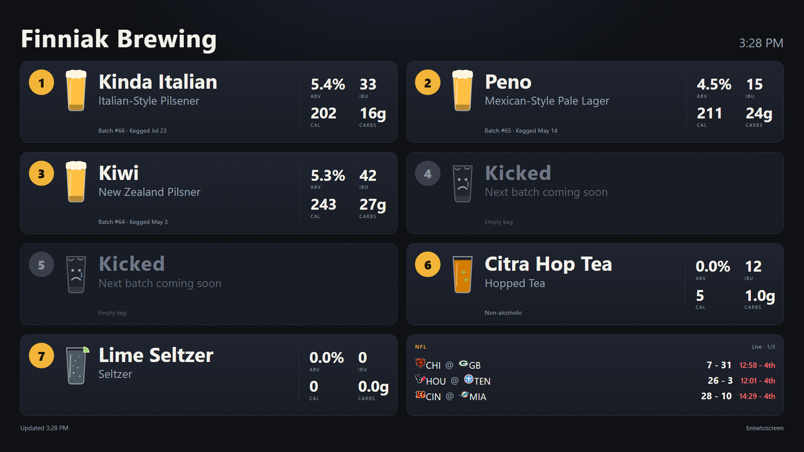

# brewtoscreen

A tap list for homebrewers. It pulls your batches from
[Brewfather](https://brewfather.app), lets you pick what's on tap, and puts
the board on your TV through a Chromecast, with the same page available to
anyone on your Wi-Fi. No screen mirroring, no retyping recipes.



**What you get**

- Beer name, style, ABV, IBU, calories and carbs per pint, keg date, and a
  glass colored by the beer's SRM, straight from Brewfather.
- Fixed tap numbers: empty taps show as **Kicked**, and a batch that's still
  fermenting shows as **Coming soon** until you log the kegging.
- Things that aren't in Brewfather (seltzer, hopped tea, cider) added by hand.
- A spare tile with live sports scores and trivia, or your brewery name.
- One-button casting from a phone, a desktop shortcut, or any URL-capable
  button, plus cast-on-boot for an always-on box.
- Optional publishing of the tap list to a GitHub repo for a public website.

It runs on anything with Node.js on the same network as the Chromecast: a
laptop while you try it, a Raspberry Pi or Orange Pi for good.

## Try it in five minutes

1. Install [Node.js](https://nodejs.org) 20 or newer.
2. Clone or download this repo, then in its folder:

   ```bash
   npm install
   npm start
   ```

3. Open <http://localhost:3000/admin.html>. It asks for your Brewfather
   **User ID** and **API key**: in the Brewfather app go to **Settings → API**,
   click **Generate**, tick **Read Batches**, and copy both values (the key is
   shown only once). Paste them in and click **Save and test**.
4. Tick the batches that are on tap, give them tap numbers, **Save taps**.
5. **Scan for devices**, then **Cast tap list** next to your TV.

Without credentials it runs with sample beers so you can see the board first.
The TV shows the admin address in its footer, so anyone at the TV knows where
to change things.

## Running it on a small board (recommended)

A Chromecast can only be driven from a device on the same network, so some box
has to stay on. A Raspberry Pi Zero 2 W, an Orange Pi Zero 2W, or similar
running Debian, DietPi, Armbian or Ubuntu is plenty; it idles at a few
megabytes of RAM. Two routes:

**From a laptop, in one command.** Get the board onto your Wi-Fi once (DietPi
and Armbian ask at first boot; the board needs a screen and keyboard for that
one step), make sure `ssh user@board-ip` works with a key
(`ssh-copy-id user@board-ip` once), then from your clone of this repo:

```bash
bash deploy/push-to-pi.sh dietpi@<board-ip>
```

It copies the project over, installs Node and dependencies if needed, writes a
systemd service that starts on boot and restarts on crashes, and starts it. It
also copies your `.env`, `data/taps.json` and `data/settings.json`, so the
board starts with the same credentials, taps and default TV as the laptop.
Run the same command again any time to ship updates.

**On the board itself.**

```bash
git clone https://github.com/DrCaiola/brewtoscreen ~/brewtoscreen
cd ~/brewtoscreen
bash deploy/install-pi.sh
```

Then open `http://<board-ip>:3000/admin.html` from a phone and finish the
setup there. Works as root or as a user with sudo.

Tips for an always-on box:

- Set `CAST_ON_START=true` in `.env` (copy `.env.example`). The board casts to
  the default TV about five seconds after it boots. If no default TV is set
  and there is exactly one Chromecast with a screen on the network, it uses
  that one automatically.
- Reserve the board's IP in your router so the address the TV loads never
  changes.
- `journalctl -u brewtoscreen -f` shows the log; `sudo systemctl restart
  brewtoscreen` restarts it.

## Setting one up for someone else

You can hand a friend or relative a board that is plug-and-play at their
house: it joins their Wi-Fi, casts to their Chromecast on its own, and shows
the admin address on their TV. All they need to give you is their Wi-Fi name
and password and, optionally, their Brewfather User ID and API key (or they
can paste those into the admin page themselves later).

Flash the card, get the board onto *your* Wi-Fi once, then on your own
brewtoscreen's admin page use **Set up a board for someone**: click *Find
boards on this Wi-Fi*, pick it, enter the board's login, their Wi-Fi, their
Brewfather details if you have them, a title and a hostname, and press *Set it
up*. No terminal; it runs over SSH from your brewtoscreen and shows a live
log. The same thing from a terminal is `bash deploy/setup-for-someone.sh
dietpi@<board-ip>`.

Either way it installs everything, adds their Wi-Fi as a second network
(yours stays, so you can test at home), sets a hostname so
`http://taps.local:3000` works from iPhones and Macs, sets their board title,
enables cast-on-boot, and prints the hand-over note. At their house they plug
it into power near the TV and wait a minute. The board's login needs
passwordless sudo (DietPi's `dietpi`, Raspberry Pi OS's default user) or use
`root`.

## One button to put it on the TV

On the admin page, scan and click **Make default** next to your TV. Then any
of these casts the board:

- Open `http://<host>:3000/cast.html` on a phone and press the big button.
  Add it to the home screen for a one-tap launcher.
- On Windows, double-click `cast-to-tv.cmd` (make a desktop shortcut).
- Hit `http://<host>:3000/go` from anything that can open a URL: a Stream
  Deck, a Home Assistant automation, a smart button, a Siri or Google
  shortcut.
- `CAST_ON_START=true` in `.env`, as above.

## The spare tile

With an odd number of taps one slot on the board is empty. On the admin page
you can fill it with:

- **Rotating info** (bottom-right): live scores for the leagues you tick
  (ESPN's public scoreboard feed) and trivia from
  [Open Trivia DB](https://opentdb.com) in the categories you choose, with the
  answer on the next slide. Scores show once per trivia loop by default, or
  after every N questions. While a game is live, a score change cuts in with
  that game, at most once every N minutes.
- **Brewery tile** (top-left): your brewery name in big type.
- Nothing.

## Publishing the tap list to a website

brewtoscreen can write the tap list as a JSON file into a GitHub repo, so a
static site (GitHub Pages, for example) can show what is on tap without
anyone reaching your LAN. It publishes a few seconds after you save taps or
custom items, once at startup, and every `PUBLISH_EVERY_HOURS`. Commits are
skipped when nothing changed.

1. On GitHub, as the account that owns the website repo, create a
   **fine-grained** personal access token at
   <https://github.com/settings/personal-access-tokens/new>: repository
   access *Only select repositories* with just the site repo, and
   **Contents: Read and write**.
2. On the admin page, in **Website**, enter the repo as `owner/name`, the
   branch, the file path, how often to republish, the token, and optionally
   the public URL where the page is shown (it appears in the board's footer).
   **Save and test** checks that the token can write to the repo before
   saving. The token is stored in `data/settings.json` on the box.

   The same settings can be put in `.env` instead (`PUBLISH_GITHUB_TOKEN`,
   `PUBLISH_REPO`, `PUBLISH_PATH`, `PUBLISH_BRANCH`, `PUBLISH_EVERY_HOURS`,
   `PUBLISH_SITE_URL`); when they are, the admin page shows them read-only.
   `GET /api/publish/preview` shows exactly what gets written.

The file looks like:

```json
{
  "title": "Finniak Brewing",
  "taps": [
    { "tap": 1, "label": null, "beer": { "name": "Kinda Italian", "style": "Italian-Style Pilsener",
      "abv": 5.4, "ibu": 33, "srm": 3.2, "calories": 202, "carbs": 15.5, "notes": null,
      "custom": false, "kind": null, "brewDate": 1783051200000, "bottlingDate": 1784764800000,
      "comingSoon": false } },
    { "tap": 4, "label": null, "beer": null }
  ],
  "updatedAt": 1791756295455
}
```

`beer: null` is a kicked tap. Custom items have `custom: true` and a `kind`.

## How the Chromecast part works

A Chromecast cannot open a URL by itself; it only runs Cast "receiver apps".
brewtoscreen launches **DashCast**, a public receiver app that loads whatever
URL it is sent, and points it at this server's board page on your LAN. The
server speaks the Cast protocol directly, so nothing is mirrored from a
computer. Each cast restarts DashCast and loads the page full-screen, which is
the reliable mode (the same approach the `catt` tool uses); once loaded, the
TV keeps the page and refreshes its data every minute by itself. Casting ends
if someone casts something else to the TV; just cast again.

Nutrition: calories and carbs are computed per US pint from each batch's
gravities (measured values when you logged them) with the standard formulas,
which is the same math Brewfather uses.

## Configuration

Everything optional lives in `.env` (see `.env.example`): port, a fixed
`PUBLIC_URL` for the TV to load, which Brewfather batch statuses to list,
cache time, cast-on-start, and the publishing settings. Brewfather credentials
can be in `.env` or entered on the admin page; the admin page's copy is saved
to `data/settings.json`. Taps, custom items, the default TV and spare-tile
settings are in `data/taps.json`. None of these files are committed.

## Files

- `server.js` - Express server, state, API routes
- `lib/brewfather.js` - Brewfather v2 client with caching and nutrition math
- `lib/cast.js` - Chromecast discovery (mDNS) and DashCast launching
- `lib/extras.js` - scores and trivia for the spare tile
- `lib/publish.js` - pushes the tap list to a GitHub repo
- `public/index.html` - the board
- `public/admin.html` - admin page
- `public/cast.html` - one-button cast page
- `deploy/` - install, push and hand-over scripts for a Linux board

## Contributing

Issues and pull requests are welcome. It is plain Node and vanilla HTML with
no build step: `npm install`, `npm start`, edit, refresh. Please keep it that
way; the point is something a homebrewer can run on a $20 board and fix at
midnight.

## License

MIT, see [LICENSE](LICENSE).
